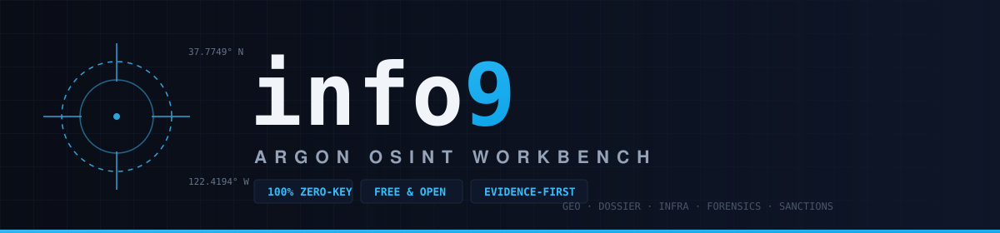

<div align="center">



**A zero-key, free & open-source intelligence workbench.**
Nine specialist instruments — geolocation, corporate unwrapping, infrastructure recon, media forensics, identity sweep, pivot chains, watchlist screening, face recon, acoustic doppler — running entirely on public data sources and in-browser computation. No paid API keys. No accounts. No subscription.

[](https://github.com/ARYAN007H/info9/actions/workflows/ci.yml)
[](LICENSE)
[](package.json)
[](CONTRIBUTING.md)

</div>

---

## Why info9

Most OSINT tooling is either a paid SaaS (Maltego, DomainTools), a pile of scattered one-off scripts, or a bookmark list. info9 is a single self-hostable workbench that:

- **Costs nothing to run.** Every data source is a free public endpoint (OpenStreetMap, Shodan InternetDB, GLEIF, RIPEstat, Cloudflare DoH, crt.sh, RDAP, Open-Meteo, Wikidata, Wayback Machine). Zero API keys, zero rate-limit budgets to buy.
- **Does the math analysts actually need.** Solar chronolocation from shadows, multi-clause spatial intersection, corporate equity propagation, domain similarity clustering — computed locally, deterministically, and covered by unit tests.
- **Keeps an evidence trail.** Every finding is written into a SHA-256 hash-chained ledger with Merkle-root integrity verification, exportable as STIX 2.1.
- **Runs where you need it.** One `npm` command, or one `docker compose up`. Your queries never touch a third-party aggregation service.

## The modules

| Module | What it does | Live data sources |
|---|---|---|
| **01 · Geolocation & Chronolocation** | Pinpoint coordinates from multi-clause infrastructure constraints (e.g. *substation ∩ rail crossing ∩ storage tank* within radii), solve time-of-day from shadow geometry via NOAA solar ephemeris, verify claimed dates against historical weather & cloud cover, profile terrain horizon from DEM radials; interactive map layers — infrastructure heatmap, **live air traffic** (adsb.lol), geotagged Commons photos, rail & marine overlays | OpenStreetMap Overpass QL, Nominatim, Open-Meteo (elevation + ERA5 archive), adsb.lol, Wikimedia Commons, OpenRailwayMap, OpenSeaMap |
| **02 · Dossier & Shell Topology** | Search legal entities worldwide, crawl GLEIF Level-2 ultimate-parent ownership chains, expand via Wikidata & OpenAlex, compute effective equity across multi-hop shells, detect circular ownership | GLEIF API, Wikidata, OpenAlex |
| **03 · Threat Infrastructure** | Full passive recon on any domain: A/AAAA/MX/NS/TXT/CAA/DMARC, registrar & creation date (RDAP), subdomains from Certificate Transparency, open ports / CPEs / CVEs per IP, BGP origin & upstreams, live-probed typosquat lookalike permutations, cross-domain cluster analysis | Cloudflare DoH, RDAP, crt.sh, Shodan InternetDB, RIPEstat |
| **04 · Media & Video Forensics** | In-browser DSP lab: Error Level Analysis, copy-move clone detection with displacement vectors, noise variance maps, JPEG ghost quality sweeps, 8× pixel loupe, live RGB histograms, EXIF integrity review | 100% client-side computation |
| **05 · Identity & Usernames** | Sweep a handle across ~700 community-indexed sites (WhatsMyName dataset) with per-probe detection strings; hits ranked and flagged for visual verification; SSRF-hardened probe checking | WhatsMyName dataset (free, community-maintained) |
| **06 · Sanctions & Evidence Ledger** | Name matching across scripts (Cyrillic/diacritic transliteration + Jaro-Winkler + Soundex + token-set) with Bayesian posterior scoring; **live screening against the real OFAC SDN list** (free Treasury CSV, parsed and cached server-side); every module finding lands in a hash-chained, tamper-evident evidence ledger with STIX 2.1 export | Live OFAC SDN CSV (U.S. Treasury) · bundled demo set for offline use |
| **07 · Watchlist** | Cross-script sanctions and PEP matching against the live list with fully disclosed scoring factors and dispositions | Live OFAC SDN CSV |
| **08 · Face Recon** | **On-device face matching**: local detection + deep face descriptors (nothing uploaded), ranked similarity against a reference corpus — username avatar sweeps, named-person portrait verification via Wikidata P18, or analyst-supplied image folders — plus same-person clustering; honest heuristic bands, never proof of identity | unavatar.io, GitHub avatars, Wikidata/Commons · 100% local inference |
| **09 · Acoustic Doppler** | Geolocate a recording from aircraft audio: spectrogram peak-tracking extracts Doppler curves, matched against ADS-B flight tracks (adsb.lol live watch or provider CSV/JSON imports) via a closed-form-f0 grid fit with timeline-offset search; joint multi-aircraft fit collapses the single-pass mirror ambiguity; RMS residual always disclosed | adsb.lol (free) · 100% local audio DSP |

## Architecture

```
┌──────────────────────────────────────────────────────────────────┐
│                     React 19 + Tailwind 4 UI                     │
│   Geolocation │ Dossier │ Infrastructure │ Forensics │ Sanctions │
└───────────────┬──────────────────────────────────────────────────┘
                │
┌───────────────┴──────────────────┐   ┌─────────────────────────┐
│        src/utils (pure TS)       │   │   Express proxy server  │
│  solarMath · osintForensics ·    │   │  CORS-free upstreams,   │
│  clueParser (unit-tested core)   │   │  crt.sh · RDAP · Wayback│
└───────────────┬──────────────────┘   └───────────┬─────────────┘
                │                                  │
┌───────────────┴──────────────────────────────────┴─────────────┐
│     Public intelligence sources (all key-free, all auditable)   │
│  Overpass · Nominatim · Open-Meteo · GLEIF · Wikidata · OpenAlex│
│  Cloudflare DoH · RDAP · crt.sh · Shodan InternetDB · RIPEstat  │
└─────────────────────────────────────────────────────────────────┘
```

The analysis core (`src/utils/`) is pure, dependency-free TypeScript with a `node:test` suite — the same math runs in the browser, in a Node CLI, or in CI.

## Quickstart

**Prerequisites:** Node.js ≥ 22.

```bash
git clone https://github.com/ARYAN007H/info9.git
cd info9
npm install
npm run dev          # → http://localhost:3000
```

**Docker (one command):**

```bash
docker compose up --build -d   # → http://localhost:3000
```

**Scripts:**

| Command | Purpose |
|---|---|
| `npm run dev` | Dev server (Vite HMR + API proxy) on `:3000` |
| `npm run build` | Production build to `dist/` |
| `npm start` | Serve the production build + API (`NODE_ENV=production`) |
| `npm test` | Unit tests (Node's built-in test runner) |
| `npm run typecheck` | Strict type gate (same one CI runs) |

## Headless CLI (same core, zero keys)

The analysis core is shared between the web UI and a headless CLI — same connectors, same rate limiting, same provenance:

```bash
npm run cli -- connectors              # list the zero-key connector registry
npm run cli -- recon example.com       # full passive domain recon + transparent risk
npm run cli -- geocode "Tower Bridge London"
npm run cli -- landmarks 35.68214,139.76308
npm run cli -- entity "Siemens AG"     # GLEIF + registry pivots
npm run cli -- screen "Viktor Morozov" 1968-04-14   # demo sanctions scoring (synthetic set)
```

Every connector declares its input/output entity kinds in a registry (`src/connectors/`), so pivots are suggested automatically — the Maltego transform-graph idea, built entirely on free public sources. Client-side per-host rate limiting and a TTL cache keep reruns inside upstream usage policies.

## Data source policy

Every upstream in the five modules is a **free, public, documented endpoint**. info9 never proxies your queries through its own aggregation backend and never requires registration. Where a browser cannot call an upstream directly (CORS or User-Agent policy), the bundled Express server forwards the request transparently and adds nothing else. Sources currently integrated:

Overpass QL · Nominatim · Open-Meteo DEM + ERA5 · GLEIF L1/L2 · Wikidata · OpenAlex · Cloudflare DNS-over-HTTPS · RDAP · crt.sh · Shodan InternetDB · RIPEstat · Wayback Machine CDX

**One optional exception, disclosed:** AI photo geolocation (upload a photo with stripped EXIF → get candidate coordinates as a *hypothesis*) uses the Gemini vision API, which needs a free key from [AI Studio](https://aistudio.google.com/apikey) in your `.env`. Without it, everything else works and the photo panel falls back to zero-key reverse-image-search links (Google Lens, Yandex, TinEye, Bing). AI candidates are always labeled `HYPOTHESIS — NOT EVIDENCE` and are corroborated through zero-key sources (Street View/satellite deep links, Overpass landmark scans, reverse search) before they belong in an evidence ledger.

## Roadmap

Phase 0 — **ship it as a real OSS project** ✅ *(this release)*

- [x] AGPL-3.0 license, CI (typecheck + tests + build), Docker packaging
- [x] Clean dependency tree, repo hygiene, community files

Phase 1 — **evidentiary integrity**

- [ ] Provenance envelope on every data point: `{ value, source, fetchedAt, confidence }` with live/unverified badges in the UI
- [ ] Remove every silent fallback so missing data is rendered as "no data", never plausible fiction
- [ ] Transparent, documented risk-scoring methodology

Phase 2 — **connector architecture** *(in progress — core shipped)*

- [x] Connector registry: one entry per source, declaring inputs/outputs so pivots auto-suggest
- [x] Headless CLI sharing the exact core (`npm run cli -- recon example.com`)
- [x] Per-host rate limiting + TTL response cache honoring upstream policies
- [ ] STIX 2.1 as canonical internal entity model across all connectors

Phase 3 — **source breadth** *(core shipped)*

- [x] Live OFAC SDN screening — the real U.S. Treasury list, zero keys (replaces synthetic-only screening)
- [x] WhatsMyName username sweep across ~700 sites with SSRF-hardened probing
- [x] URLScan.io, GitHub account recon, direct IP geolocation, Wayback history connectors
- [ ] HIBP breach lookups (needs a key — will be optional like the vision module)
- [ ] SEC EDGAR & Companies House · AlienVault OTX · email/phone recon

Phase 4 — **the analysis layer**

- [ ] Automated pivot chains: one input → full cross-module investigation graph
- [ ] Dossier report export (Markdown/PDF) with evidence hashes and methodology citations
- [ ] IOC export (STIX/MISP)

Phase 5 — **ecosystem**

- [ ] Documentation site with per-module methodology pages
- [ ] Public demo instance

## Methodology library

Every module documents how it reaches its conclusions — the math, the rule tables, the honest limitations, and the citations — in [docs/methodology/](docs/methodology/). The PDF dossier cites the relevant methodology page per section, so a printed report explains its own reasoning.

## Responsible use

info9 is built for **defensive research, verification journalism, and lawful investigation**. You are responsible for using it in compliance with the law and with the terms of service of the upstream data sources. Do not use info9 to harass, dox, stalk, or profile private individuals. When publishing findings, verify before you amplify — that is what the evidence ledger is for.

## Contributing

Contributions are welcome — new connectors, module features, tests, docs. Read [CONTRIBUTING.md](CONTRIBUTING.md) to get started. Good first issues are labelled.

## License

info9 is licensed under the [GNU Affero General Public License v3.0 or later](LICENSE). If you host a modified version for others, you must share your source — which is exactly the spirit this project runs on.

Built on the shoulders of open infrastructure: OpenStreetMap contributors, the Internet Archive, Shodan's free InternetDB, GLEIF, RIPE NCC, Open-Meteo, and the Bellingcat community whose published methodologies inspired several modules.
